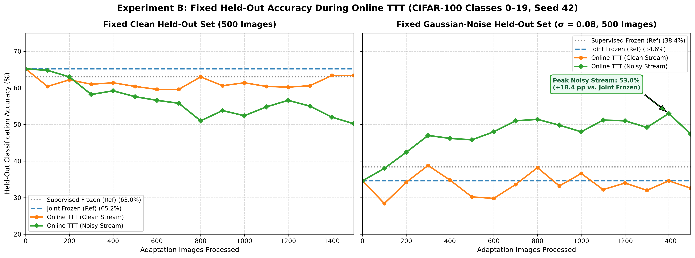

# Experiment B (`11.14–11.20`): Periodic Held-Out Evaluation of Online TTT on CIFAR-100 (Classes 0–19)

**Author**: Tuong (Lead, Experiment B)  
**Date**: November 18, 2026  
**Code Revision**: `010226f` (branch `tuong/exp-b-revised`)  
**Hardware**: Google Colab **Tesla T4** GPU (`cuda`, PyTorch `2.14.1+cu130`, CUDA `13.0`)  
**Configuration**: `configs/ttt_cifar100_exp_b_held_out.yaml`  
**Split File**: `data/ttt_exp_b_held_out_draft.json` (prepared by Khoi on `origin/khoi/ttt-evaluation` @ `c71dd5f`)

**Deliverable Artifacts**:
- **200-image pilot CSV & audit**: `results/exp_b_held_out_pilot.csv`, `results/exp_b_held_out_pilot_checks.json` (`16` rows, checkpoints `[0, 100, 200]`)
- **205-image Khoi parity check CSV & audit**: `results/exp_b_held_out_pilot_205.csv`, `results/exp_b_held_out_pilot_205_checks.json` (`20` rows, checkpoints `[0, 100, 200, 205]`)
- **Full 1,500-image one-seed CSV & audit**: `results/exp_b_held_out_seed42.csv`, `results/exp_b_held_out_seed42_checks.json` (`68` rows, checkpoints `[0, 100, ..., 1500]`)
- **Held-out trajectory figure**: `results/exp_b_held_out_accuracy_plot.png` (generated from CSV via `results/generate_plot.py`)

---

## 1. Executive Summary & Key Findings

Evaluating the current adapted model at fixed `100`-image intervals on the **same fixed 500-image held-out test set** (`0` through `1,500` adaptation images) isolates how continuous rotation-based TTT changes generalization on both clean and corrupted distributions without changing the evaluation samples:

1. **Noisy Adaptation Stream (`online_ttt`, `stream=noisy`)**:
   - **On the fixed noisy held-out set ($\sigma=0.08$)**: Held-out accuracy starts at **`34.60%`** (`173/500`, matching `joint_frozen`), climbs monotonically through early adaptation (`38.00%` at `100`, `42.40%` at `200`, `47.00%` at `300`), exceeds `51%` by `700` images, **peaks at `53.00%` (`265/500`, `+18.40 pp` vs. `joint_frozen` and `+14.60 pp` vs. `supervised_frozen`) at `1,400` adaptation images**, and finishes at **`47.40%` (`237/500`, `+12.80 pp` vs. `joint_frozen`)** at `1,500` images.
   - **Cross-domain trade-off on the fixed clean held-out set**: As shared features adapt continuously to Gaussian-noise images, clean held-out accuracy decreases from **`65.20%`** (`n=0`) to **`50.20%`** (`n=1500`, `-15.00 pp` vs. `joint_frozen`). Adaptation improves corrupted performance at the expense of clean-image retention when the stream stays corrupted.

2. **Clean Adaptation Stream (`online_ttt`, `stream=clean`)**:
   - **On the fixed clean held-out set**: Accuracy initially dips from **`65.20%`** (`n=0`) to `59.60%–62.20%` (`100–700`), rebounds to `63.00%` (`800`), and stabilizes at **`63.40%` (`317/500`, `-1.80 pp` vs. `joint_frozen`, `+0.40 pp` above `supervised_frozen`)** at `1,400` and `1,500` images.
   - **On the fixed noisy held-out set**: Without seeing corrupted images during adaptation, noisy held-out accuracy stays near the `joint_frozen` baseline (`34.60%` at `n=0`, fluctuating between `28.40%` and `38.80%`, ending at `32.60%` at `n=1500`).

3. **Frozen Reference Baselines**:
   - `supervised_frozen` (`checkpoints/exp_b_supervised_seed42.pt`): **`63.00%`** (`315/500`) clean / **`38.40%`** (`192/500`) noisy.
   - `joint_frozen` (`checkpoints/exp_b_joint_seed42.pt`): **`65.20%`** (`326/500`) clean / **`34.60%`** (`173/500`) noisy.



---

## 2. Prior-Evaluation Data Reuse Disclosure (Shared Rule 11)

> [!IMPORTANT]
> **These 500 held-out images are not completely new unseen data.** Per Khoi's split manifest (`data/ttt_exp_b_held_out_draft.json`, `prior_evaluation_reuse: true`) and our automated split audit (`*_checks.json`), the `1,500` adaptation images and `500` held-out images are a disjoint partition (`1,500 + 500 = 2,000`) of the **exact 2,000 CIFAR-100 test images (classes 0–19) in `data/exp_b_test_membership.json`** that were already examined in the Nov 11 Experiment B run (`results/ttt_summary.csv`). Both splits remain strictly disjoint from each other and from the `9,000` source training and `1,000` validation images in `data/shared_c20_membership.json`.

---

## 3. Checkpoints, Locked Settings & Exact Run Commands

### 3.1 Checkpoints & Locked Settings
- **Source checkpoints (reused unchanged from Nov 11, seed 42)**:
  - Supervised baseline: `checkpoints/exp_b_supervised_seed42.pt`
  - Joint baseline & TTT starting state: `checkpoints/exp_b_joint_seed42.pt`
- **Model architecture**: `SmallResNetTTT` (`GroupNorm(16)`, `0` BatchNorm layers, `dropout=0.2` turned off during `model.eval()`, unmasked `100`-output classification head evaluated on classes `0–19`).
- **Adaptation settings**: `SGD(lr=0.001, momentum=0.0)` updating `model.features` only (`classifier` and `rotation_head` frozen), `ttt_steps=1` per image, `lambda_rot=1.0`, `test_batch_size=1`.
- **Corruption settings**: Deterministic per-sample Gaussian noise ($\sigma=0.08$, `noise_seed=42`, clamped to `[0, 1]` before internal channel normalization).
- **Evaluation schedule**: Fixed `500`-image clean and noisy held-out views (`eval_batch_size=64`) at `0` images and every `100` adaptation images (`eval_interval=100`). Clean and noisy adaptation streams each start from a fresh copy of `exp_b_joint_seed42.pt` and carry model and optimizer state across evaluation pauses.

### 3.2 Exact Commands

```bash
# 1. Verify split disjointness, source leakage, and prior-test overlap
.venv/bin/python -m src.ttt_cifar100 --held-out --check-splits-only

# 2. 200-image pilot (checkpoints 0, 100, 200) on Colab Tesla T4 GPU
python3 -m src.ttt_cifar100 --held-out \
  --split-file data/ttt_exp_b_held_out_draft.json \
  --max-adapt-images 200 \
  --output-csv results/exp_b_held_out_pilot.csv \
  --device cuda --overwrite

# 3. 205-image remainder pilot parity check (checkpoints 0, 100, 200, 205) on Colab T4 GPU
python3 -m src.ttt_cifar100 --held-out \
  --split-file data/ttt_exp_b_held_out_draft.json \
  --max-adapt-images 205 \
  --output-csv results/exp_b_held_out_pilot_205.csv \
  --device cuda --overwrite

# 4. Full 1,500-image one-seed run (checkpoints 0, 100, ..., 1500) on Colab T4 GPU
python3 -m src.ttt_cifar100 --held-out \
  --split-file data/ttt_exp_b_held_out_draft.json \
  --output-csv results/exp_b_held_out_seed42.csv \
  --device cuda --overwrite

# 5. Rebuild held-out accuracy plot directly from CSV
.venv/bin/python -c "from results.generate_plot import generate_held_out_plot; generate_held_out_plot()"
```

---

## 4. 200-Image & 205-Image Pilot Results (with Khoi CPU Parity Check)

Both the 200-image pilot (`results/exp_b_held_out_pilot.csv`) and the 205-image remainder check (`results/exp_b_held_out_pilot_205.csv`) passed all state-preservation invariants (`all_checks_passed: true`). Comparing our **Colab T4 GPU** 205-image run against **Khoi's CPU** replay (`results/ttt_exp_b_draft_205.csv` on `origin/khoi/ttt-evaluation`):

| Condition | Stream | Checkpoints | Clean Held-Out (T4 / Khoi CPU) | Noisy Held-Out (T4 / Khoi CPU) | Adapt Time (T4 vs. CPU) |
| --- | --- | --- | --- | --- | --- |
| `supervised_frozen` | `none` | `0` | `63.00%` / `63.00%` (`315/500`) | `38.40%` / `38.40%` (`192/500`) | `0.000s` / `0.000s` |
| `joint_frozen` | `none` | `0` | `65.20%` / `65.20%` (`326/500`) | `34.60%` / `34.60%` (`173/500`) | `0.000s` / `0.000s` |
| `online_ttt` | `clean` | `0 → 100 → 200 → 205` | `65.2 → 60.2 → 62.0 → 62.8%` vs. `65.2 → 60.2 → 62.4 → 62.8%` | `34.6 → 28.4 → 33.6 → 33.2%` vs. `34.6 → 28.4 → 34.0 → 33.6%` | `1.363s` vs. `8.941s` |
| `online_ttt` | `noisy` | `0 → 100 → 200 → 205` | `65.2 → 64.8 → 63.2 → 60.8%` vs. `65.2 → 64.8 → 63.2 → 60.8%` | `34.6 → 38.0 → 42.4 → 41.0%` vs. `34.6 → 38.0 → 42.4 → 41.0%` | `1.386s` vs. `8.594s` |

The noisy adaptation stream matches Khoi's CPU accuracy **bit-for-bit across every checkpoint and held-out view**, and Colab T4 runs ~`6.2–6.6×` faster on adaptation and ~`34×` faster on held-out evaluation (`~0.055s` vs. `~1.87s` per 500-image pass). *(Note: the slight `1–2`-image difference on intermediate clean-stream checkpoints between `exp_b_held_out_pilot.csv` and `exp_b_held_out_pilot_205.csv` / `exp_b_held_out_seed42.csv` reflects non-deterministic cuDNN/CUDA floating-point accumulation across runs.)*

---

## 5. Full 1,500-Image Held-Out Trajectory (`results/exp_b_held_out_seed42.csv`)

Reference baselines on the fixed 500-image held-out set:
- **Clean held-out**: `supervised_frozen = 63.00%` (`315/500`), `joint_frozen = 65.20%` (`326/500`)
- **Noisy held-out**: `supervised_frozen = 38.40%` (`192/500`), `joint_frozen = 34.60%` (`173/500`)

Since `online_ttt` starts at `n=0` from `joint_frozen` (`65.20%` clean, `34.60%` noisy), $\Delta$ vs. `joint_frozen` and $\Delta$ vs. starting accuracy are identical:

| Adapt Images | Clean Stream → Clean Eval ($\Delta$) | Clean Stream → Noisy Eval ($\Delta$) | Noisy Stream → Clean Eval ($\Delta$) | Noisy Stream → Noisy Eval ($\Delta$) | Clean Adapt Time | Noisy Adapt Time |
| ---: | ---: | ---: | ---: | ---: | ---: | ---: |
| **0** | `65.20%` (`0.00 pp`) | `34.60%` (`0.00 pp`) | `65.20%` (`0.00 pp`) | `34.60%` (`0.00 pp`) | `0.000s` | `0.000s` |
| **100** | `60.40%` (`-4.80 pp`) | `28.40%` (`-6.20 pp`) | `64.80%` (`-0.40 pp`) | `38.00%` (`+3.40 pp`) | `0.698s` | `0.793s` |
| **200** | `62.20%` (`-3.00 pp`) | `34.20%` (`-0.40 pp`) | `63.00%` (`-2.20 pp`) | `42.40%` (`+7.80 pp`) | `1.413s` | `1.682s` |
| **300** | `61.00%` (`-4.20 pp`) | `38.80%` (`+4.20 pp`) | `58.20%` (`-7.00 pp`) | `47.00%` (`+12.40 pp`) | `2.339s` | `2.475s` |
| **400** | `61.40%` (`-3.80 pp`) | `34.80%` (`+0.20 pp`) | `59.20%` (`-6.00 pp`) | `46.20%` (`+11.60 pp`) | `3.209s` | `3.397s` |
| **500** | `60.40%` (`-4.80 pp`) | `30.20%` (`-4.40 pp`) | `57.60%` (`-7.60 pp`) | `45.80%` (`+11.20 pp`) | `4.102s` | `4.102s` |
| **600** | `59.60%` (`-5.60 pp`) | `29.80%` (`-4.80 pp`) | `56.60%` (`-8.60 pp`) | `48.00%` (`+13.40 pp`) | `4.816s` | `4.792s` |
| **700** | `59.60%` (`-5.60 pp`) | `33.60%` (`-1.00 pp`) | `55.80%` (`-9.40 pp`) | `51.00%` (`+16.40 pp`) | `5.516s` | `5.464s` |
| **800** | `63.00%` (`-2.20 pp`) | `38.20%` (`+3.60 pp`) | `51.00%` (`-14.20 pp`) | `51.40%` (`+16.80 pp`) | `6.188s` | `6.149s` |
| **900** | `60.60%` (`-4.60 pp`) | `33.20%` (`-1.40 pp`) | `53.80%` (`-11.40 pp`) | `49.80%` (`+15.20 pp`) | `6.859s` | `6.843s` |
| **1000** | `61.40%` (`-3.80 pp`) | `36.60%` (`+2.00 pp`) | `52.40%` (`-12.80 pp`) | `48.00%` (`+13.40 pp`) | `7.551s` | `7.569s` |
| **1100** | `60.40%` (`-4.80 pp`) | `32.20%` (`-2.40 pp`) | `54.80%` (`-10.40 pp`) | `51.20%` (`+16.60 pp`) | `8.226s` | `8.321s` |
| **1200** | `60.20%` (`-5.00 pp`) | `34.00%` (`-0.60 pp`) | `56.60%` (`-8.60 pp`) | `51.00%` (`+16.40 pp`) | `8.918s` | `9.036s` |
| **1300** | `60.60%` (`-4.60 pp`) | `32.00%` (`-2.60 pp`) | `55.00%` (`-10.20 pp`) | `49.20%` (`+14.60 pp`) | `9.620s` | `9.733s` |
| **1400** | **`63.40%`** (`-1.80 pp`) | `34.60%` (`0.00 pp`) | `52.00%` (`-13.20 pp`) | **`53.00%` (`+18.40 pp`)** | `10.319s` | `10.449s` |
| **1500** | **`63.40%`** (`-1.80 pp`) | `32.60%` (`-2.00 pp`) | `50.20%` (`-15.00 pp`) | `47.40%` (`+12.80 pp`) | `11.057s` | `11.115s` |

### Runtime Breakdown (Colab Tesla T4 GPU)
- **Clean-stream adaptation (`1,500` updates)**: `11.057s` adaptation (`~7.4 ms/image`); held-out evaluation across all `16` checkpoints took `0.866s` (clean view) + `0.898s` (noisy view) = `1.764s` total (`~0.055s` per 500-image evaluation pass).
- **Noisy-stream adaptation (`1,500` updates)**: `11.115s` adaptation (`~7.4 ms/image`); held-out evaluation across all `16` checkpoints took `0.868s` (clean view) + `0.912s` (noisy view) = `1.780s` total.
- **Frozen baselines**: `supervised_frozen` eval took `0.167s` total (`0.086s` clean + `0.081s` noisy); `joint_frozen` eval took `0.120s` total (`0.060s` clean + `0.059s` noisy).

---

## 6. Differences vs. Earlier Nov 11 Experiment B Runs & Verification Status

1. **Evaluation protocol difference**:
   - **Nov 11 (`results/ttt_summary.csv`, `results/ttt_window_summary.csv`)**: Evaluated `online_ttt` online on the incoming `2,000`-image stream itself (each image adapted and scored immediately, summarized over `200`-image rolling windows: `62.10%` clean, `48.95%` noisy on MPS; `61.75%` clean, `48.80%` noisy on Colab T4 CUDA).
   - **This week (`results/exp_b_held_out_seed42.csv`)**: Separates `1,500` adaptation images from a fixed `500`-image held-out set and evaluates **both clean and noisy views** at every `100`-step checkpoint. This cleanly reveals both in-domain adaptation gains (`+12.80 pp` at end, `+18.40 pp` peak on noisy→noisy) and out-of-domain drift (`-15.00 pp` on noisy→clean) that single-stream evaluation could not measure.
2. **State-preservation checks (`results/exp_b_held_out_seed42_checks.json`)**:
   - `all_checks_passed: true` across all 4 run entries (`supervised_frozen`, `joint_frozen`, `online_ttt` clean, `online_ttt` noisy).
   - Confirmed per-checkpoint bit-for-bit equality of model weights/GroupNorm buffers, SGD optimizer state, and CPU + CUDA RNG states before vs. after held-out evaluation, `frozen_heads_preserved: true`, `features_adapted: true`, and exact `500` ordered predictions per view per checkpoint.
