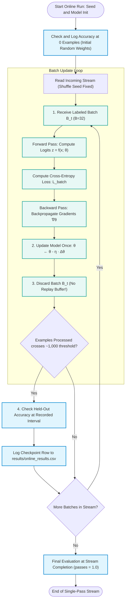
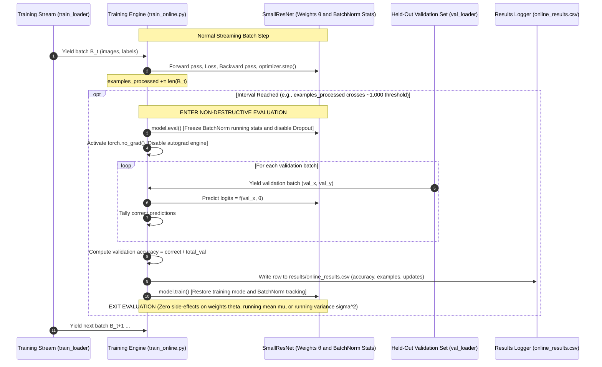

# Online Learning Guide: Single-Pass Online Learning

**Project:** Online Learning – The Human Way  
**Author:** Tuong (Method Explanation & Protocol Review)  
**Deliverable:** Week 2 Online Learning Guide & Review Reference  
**Context:** CIFAR-100 Shuffled Online Learning (Debugging subset: classes 0–19; Full stage: classes 0–99)  

> **Week 2 Status Note (October 13, 2026):** Following Dr. Athitsos's guidance, our project has transitioned its primary focus from sequential class-incremental continual learning (Task 1 $\to$ Task 2 with EWC) to **shuffled single-pass online learning**. Week 1's work on Elastic Weight Consolidation (EWC) and Fisher information matrix estimation (`docs/ewc_guide.md`) is preserved as valuable background reference for potential future extensions, but is **deferred** for our immediate deliverables.

---

## 1. Overview & Purpose

In Week 2, our project transitions from sequential task-based continual learning (Task 1 $\to$ Task 2) to **shuffled single-pass online learning**, following Dr. Athitsos's confirmed guidance on October 13, 2026 (*"Yes, this is exactly what I had in mind"*).

Instead of training a model on separate groups of classes one after another across dozens of epochs, we combine all target classes upfront and feed them to the model in a single continuous stream of small mini-batches.

### Core Research Question

> *"How well can an artificial neural network learn from a continuous stream of incoming labeled data when each example is seen only once, without storing past examples in a replay memory?"*


---

## 2. Core Concepts: Online Learning vs. Offline Training

### 2.1. Analogy: Reviewing a Textbook vs. Real-Time Experience

To understand the conceptual divergence between offline training and online learning, consider two distinct ways a human can learn:

```text
+----------------------------------------------------------------------------------------------------+
|                                    OFFLINE TRAINING                                                |
|                                                                                                    |
|   [ Textbook: 500 Pages ] <==== (Review 50 Times Cover-to-Cover)                                   |
|   - The student has all pages available at their desk at all times.                                |
|   - Epoch 1: Read pages 1 to 500.                                                                  |
|   - Epoch 2: Re-read pages 1 to 500 (reshuffled order).                                            |
|   - ...                                                                                            |
|   - Epoch 50: Re-read pages 1 to 500. Early mistakes are corrected across repeated passes.         |
+----------------------------------------------------------------------------------------------------+

+----------------------------------------------------------------------------------------------------+
|                                    ONLINE LEARNING                                                 |
|                                                                                                    |
|   Incoming Experiences:  [ Event 1 ] ---> [ Event 2 ] ---> [ Event 3 ] ---> [ Event 4 ] ---> ...   |
|   - Events occur in real time like frames on a conveyor belt.                                      |
|   - You observe Event 1, update your knowledge, and Event 1 is gone forever.                       |
|   - You cannot pause reality, rewind time, or review past days 50 times.                           |
|   - Your brain must extract whatever generalizable signal it can on the spot.                      |
+----------------------------------------------------------------------------------------------------+
```

* **Offline Training:** The entire training dataset is collected, labeled, and stored on disk upfront. The training loop executes multiple **epochs** (passes over the entire dataset). In each epoch, the dataset is reshuffled, partitioned into mini-batches, and processed by gradient descent. If the model makes poor predictions on image #42 in Epoch 1, it has 49 subsequent opportunities to revisit and adjust its weights for image #42.
* **Online Learning:** Data arrives as an ongoing stream. The model receives a small batch of incoming images, makes predictions, calculates loss, updates its weights **exactly once**, and immediately discards the batch. It will never see those identical images again.

### 2.2. Comparison Table: Online Learning vs. Offline Training

The following table summarizes the operational and mathematical differences between standard multi-pass offline training and single-pass online learning:

| Dimension | Multi-Pass Offline Training | Single-Pass Online Learning |
|---|---|---|
| **Data Availability** | Full dataset stored in disk/RAM; accessible globally at any time | Stream of mini-batches; only current batch is accessible |
| **Passes Through Data** | **Multiple epochs** (e.g., $E = 10$ to $50$ passes; `passes = 50.0`) | **Strictly 1 pass** (`passes = 1.0`); each image seen once |
| **Batch Visibility** | Batches are generated repeatedly every epoch | Batch is visible for one step, then **immediately discarded** |
| **Total Gradient Steps** | $E \times \lceil N_{\text{train}} / B \rceil$ updates | Exactly $\lceil N_{\text{train}} / B \rceil$ updates |
| **Past Data Retention** | Full dataset available across epochs | **No replay** (no memory buffer $\mathcal{M}$) |
| **Memory Footprint** | Scales with dataset size or requires constant disk I/O | $O(1)$ memory with respect to stream length (weights only) |
| **Compute Overhead** | High ($E \times$ forward and backward passes) | Minimal ($1\times$ single-pass compute budget) |
| **Primary Challenge** | Preventing overfitting and empirical error minimization | **Sample efficiency** (extracting signal from one look) |
| **Evaluation Focus** | Static validation accuracy after multi-epoch convergence | Dynamic **learning curve** ($A$ vs. `examples_processed`) |

### 2.3. Architecture Comparison

---
#### Offline Training Architecture
```text
=================================================================================================
  Disk / Storage: [ Full Dataset D_train (N samples) ]
         |
         v
  +---------------------------------------------------------------------------------------------+
  |  OUTER LOOP: for epoch = 1 to E (e.g., 50 epochs)                                           |
  |    Shuffle all N samples in D_train                                                         |
  |    +---------------------------------------------------------------------------------------+|
  |    | INNER LOOP: for batch = 1 to ceil(N / B)                                              ||
  |    |   Load batch B_k                                                                      ||
  |    |   Forward Pass -> Compute Loss -> Backward Pass -> Optimizer Step                     ||
  |    +---------------------------------------------------------------------------------------+|\
  +---------------------------------------------------------------------------------------------+
  Result: Model sees every sample 50 times. High compute, high sample reuse.
  =================================================================================================
```
#### Online Learning Architecture
```text 
=================================================================================================
  Incoming Stream: ===> [Batch 1] ===> [Batch 2] ===> [Batch 3] ===> ... ===> [Batch K] ===> END
                             |              |              |                     |
                             v              v              v                     v
                         [Step 1]       [Step 2]       [Step 3]              [Step K]
                             |              |              |                     |
                             v              v              v                     v
                         DISCARD        DISCARD        DISCARD               DISCARD
  Result: Single linear loop over K batches. Model sees every sample exactly once (passes = 1.0).
  Zero replay buffers. Continuous state accumulation purely within network weights theta.
=================================================================================================
```

---

## 3. How Learning from Incoming Batches Works

In online learning, the neural network acts as a continuous learner. It maintains an active set of parameters $\theta$ and optimizer state that evolve incrementally as data arrives.

### 3.1. The 4-Step Execution Flow

Every online training implementation must follow this canonical sequence:

```text
Receive labeled batch
→ Update the model once
→ Move to the next batch
→ Check held-out accuracy at recorded intervals
```

### 3.2. Detailed Walkthrough of the 4 Steps

1. **Receive labeled batch:**
   A mini-batch of images and ground-truth labels arrives from the data stream:
   $$\mathcal{B}_t = \{(x_i, y_i)\}_{i=1}^{B}$$
   where $B = 32$ is the standard batch size. The stream is ordered by a single global shuffle performed once before training starts using a recorded seed (`stream_seed`). The batch may contain an arbitrary mix of classes. Even the final smaller batch (when $N_{\text{train}}$ is not evenly divisible by 32) is preserved and processed.
2. **Update the model once:**
   The network performs a standard mini-batch gradient descent update:
   * **Forward pass:** The model computes raw logit predictions $z_i = f_\theta(x_i) \in \mathbb{R}^{100}$ for each image in the batch.
   * **Loss computation:** Cross-entropy loss $\mathcal{L}_{\text{batch}}(\theta)$ is calculated across the 32 samples.
   * **Backward pass:** Gradients $\nabla_\theta \mathcal{L}_{\text{batch}}(\theta)$ are computed via backpropagation.
   * **Optimizer step:** Parameter values $\theta$ are updated using the optimizer (e.g., Adam or SGD).
   * **Zero gradients:** Gradient buffers are cleared (`optimizer.zero_grad()`) in preparation for the next batch.
3. **Move to the next batch:**
   Batch $\mathcal{B}_t$ is completely discarded from memory. No images or feature embeddings are stored in a replay buffer. Model weights $\theta$ and optimizer momentum buffers carry forward into step $t+1$.
4. **Check held-out accuracy at recorded intervals:**
   At pre-specified checkpoints (before training begins at $0$ examples, approximately every $1{,}000$ training examples processed, and immediately upon stream completion), training temporarily pauses. Generalization accuracy is measured on a separate, held-out validation split without updating model parameters or running statistics.

### 3.3. Workflow Diagram: The 4-Step Batch Loop



---

## 4. Why Classes Are Mixed Upfront (Online Learning vs. Continual Learning)

### 4.1. Week 1 vs. Week 2 Contrast

In Week 1, our team explored **class-incremental continual learning**:
* The model first trained exclusively on **Task 1 (classes 0–9)** for 50 epochs.
* Then the model switched abruptly to **Task 2 (classes 10–19)** for 50 epochs.

This created an artificial, severe distribution shift: when Task 2 began, images of classes 0–9 vanished completely. Because the loss function only saw classes 10–19, backpropagation modified weights solely to satisfy Task 2, catastrophically erasing the features required for Task 1.

```text
WEEK 1: CLASS-INCREMENTAL CONTINUAL LEARNING (DISJOINT TASKS)
====================================================================================
  Phase 1: Classes 0–9 only  (50 Epochs)   ===> Task Boundary (Abrupt Shock)
  Phase 2: Classes 10–19 only (50 Epochs)  ===> Catastrophic Forgetting of Classes 0–9!
====================================================================================

WEEK 2: SHUFFLED SINGLE-PASS ONLINE LEARNING (STATIONARY STREAM)
====================================================================================
  Pool all classes 0–19 upfront -> Shuffle once with seed -> Stream in batches of 32
  Every batch is a natural random draw from the fixed underlying 20-class distribution.
  No task boundaries. No abrupt distribution shifts.
====================================================================================
```

### 4.2. Stationary Class Distribution ($P(Y=k) = \frac{1}{20}$)

In Week 2, all 20 classes are combined before shuffling. The underlying data-generating distribution is **stationary**:
$$P(Y = k) = \frac{1}{20} = 0.05 \quad \text{for all } k \in \{0, 1, \dots, 19\}$$

Because every class has an equal probability of appearing at any point in the stream, the network is never starved of gradient signals for any class group. Classes 0–9 continue to appear alongside classes 10–19 from the first batch to the last.

### 4.3. Natural Stochastic Variation in Mini-Batches

With $B = 32$ and $C = 20$ classes, it is mathematically impossible for every batch to contain an equal representation of all classes ($32 / 20 = 1.6$ images per class).

By chance, individual batches will exhibit natural variance:
* Batch 1 might contain: 3 beavers, 0 dolphins, 2 roses, 4 sunflowers, 1 otter, ...
* Batch 2 might contain: 0 beavers, 3 dolphins, 1 rose, 0 sunflowers, 2 otters, ...

**This variation is completely expected and realistic.** We do not force batches to be balanced or oversample underrepresented classes. The network learns to absorb these noisy, natural fluctuations through stochastic gradient descent.

### 4.4. Finite Dataset Simulation Limit

In true real-world online learning (e.g., a camera mounted on an autonomous vehicle), data arrives from an infinite, continuous stream. In our academic benchmark, we use CIFAR-100, which has a finite collection of 500 training images per class.

Our single-pass shuffled stream is therefore a **finite without-replacement stream**. Shuffling the training set once simulates an online data arrival process, but after $\lceil N_{\text{train}} / 32 \rceil$ batches, the stream terminates.

---

## 5. What "One Pass" and "No Replay" Mean: Practical Trade-Offs

Two strict invariants govern our Week 2 online baseline: **One Pass** and **No Replay**.

```text
+-----------------------------------+-----------------------------------+
|              ONE PASS             |             NO REPLAY             |
|                                   |                                   |
| - Exactly 1 view per image.       | - Batch discarded after update.   |
| - passes = 1.0 at stream end.     | - Zero episodic memory buffer.    |
| - Total steps = ceil(N_train / B) | - Weights θ are the only memory.  |
+-----------------------------------+-----------------------------------+
```

### 5.1. Single Pass ($passes = 1.0$)

* **Definition:** The training script iterates through the training stream once and terminates.
* **Why it matters:** In edge computing, sensor networks, or high-throughput financial feeds, the volume of incoming data is far too large to store on disk for 50-epoch retraining. The learning algorithm must extract signal on the fly.

### 5.2. No Replay (No Memory Buffer)

* **Definition:** Once the model completes its forward pass, backward pass, and optimizer step on batch $\mathcal{B}_t$, that batch is dropped from RAM. The script maintains no memory buffer $\mathcal{M} = \{(x_m, y_m)\}$ of past images to interleave with future batches.
* **Why it matters:** Operating without a replay buffer tests whether the architecture and optimization rule can accumulate knowledge **strictly within the continuous parameter space $\theta$**.

### 5.3. Practical Trade-Offs

| System Metric | With Replay Buffer | Without Replay Buffer (Online Learning) |
|---|---|---|
| **Memory Complexity** | $O(M)$ buffer memory; scales with stored samples | **$O(1)$ constant memory**; only model weights $\theta$ and optimizer state |
| **Compute Complexity** | High; each step processes current batch + buffer samples | **Low; exactly 1 forward/backward pass per sample** |
| **Data Privacy (GDPR)** | Risky; storing raw images violates privacy regulations | **Compliant**; raw data discarded immediately after processing |
| **Hardware Suitability** | Requires large RAM/SSD (problematic on tiny edge MCUs) | Ideal for low-power edge devices and microcontrollers |
| **Catastrophic Forgetting**| Mitigated by continually re-training on stored samples | Mitigated naturally by upfront class mixing in stationary stream |
| **Sample Efficiency** | High (images are re-experienced multiple times) | **Low (fundamental challenge of single-pass learning)** |

> [!NOTE] **The Core Engineering Challenge: Sample Efficiency**  
> In offline training, high accuracy is achieved because the optimizer revisits the same training samples 50 times, allowing gradient descent to carve out intricate decision boundaries. In single-pass online learning, the model gets **only one fleeting look** at each image. The fundamental research challenge is therefore **sample efficiency**: how much generalizable structure can a deep network absorb from a single pass through 20 classes?

---

## 6. Why Learning Progress Replaces Forgetting as the Main Focus

### 6.1. Obsoleting the Catastrophic Forgetting Metric ($F_1$)

In Week 1's continual learning setting, the central metric was **Task 1 catastrophic forgetting** ($F_1$):
$$F_1 = A_{1, 1} - A_{1, 2}$$
where:
* $A_{1, 1}$ was Task 1 test accuracy immediately after training on Task 1.
* $A_{1, 2}$ was Task 1 test accuracy after subsequent training on Task 2.

In Week 2, **$F_1$ is mathematically obsolete**:
1. There are no separate Task 1 and Task 2 stages.
2. Classes 0–19 are mixed uniformly across the entire stream.
3. Classes 0–9 never disappear; they continue to be seen in later batches.

Because there is no moment where old classes are abruptly replaced by new classes, measuring $A_{1, 1} - A_{1, 2}$ is meaningless.

### 6.2. The New Metric: Learning Progress Across `examples_processed`

Instead of measuring what the network *forgets*, we measure **what the network acquires over time**.

We evaluate held-out validation accuracy as a function of cumulative training examples seen:
$$A(n) \quad \text{where } n = \text{examples\_processed} \in [0, N_{\text{train}}]$$

```text
ACCURACY (%)
 ^
 |                                                * (Final Accuracy ~25-35%)
 |                                      *    *
 |                            *    *
 |                  *    *
 |        *    *
 |  *  *
 0--------------------------------------------------------> EXAMPLES PROCESSED
 0     1000   2000   3000   4000   5000   6000   7000   8000
```

### 6.3. What the Online Learning Curve Reveals

Plotting validation accuracy against `examples_processed` (`results/figures/online_learning_curve.png`) provides four critical insights:
1. **Initial Zero-Shot Baseline ($n = 0$):** Shows the performance of randomly initialized weights before any training data is seen. Because our protocol mandates an unmasked 100-output classifier (Invariant 2 forbids task-specific prediction masks), the model predicts by taking $\text{argmax}$ across all 100 logits. For randomly initialized weights, uniform random guessing yields an expected initial baseline of $A(0) \approx \frac{1}{100} = 1.0\%$ ($0.0100$). A common misconception is to expect $\frac{1}{20} = 5.0\%$, but that only occurs if evaluation artificially masks out unobserved classes 20–99, which violates the fixed-classifier protocol.
2. **Initial Plasticity (Early Slope):** How quickly does the network gain traction in the first $1{,}000$ to $2{,}000$ examples? A steep initial slope indicates rapid representation formation.
3. **Monotonicity vs. Volatility:** Does validation accuracy climb smoothly, or does it fluctuate wildly due to batch noise or aggressive learning rates?
4. **Asymptotic Single-Pass Capacity:** Where does accuracy level off as the stream nears $N_{\text{train}}$? This tells us the upper bound of single-pass learning for our architecture without replay.

---

## 7. Side-Effect-Free Evaluation Protocol

In an online learning experiment, we periodically evaluate the model on a separate held-out validation set. **It is critical that the evaluation step itself does not corrupt, alter, or leak information into the training process.**

### 7.1. The Three Non-Destructive Invariants

When evaluating the model at checkpoint intervals:

1. **Disable Gradient Calculation (`torch.no_grad()`):**
   * *Autograd Mechanics:* During training, PyTorch's autograd engine dynamically constructs a Directed Acyclic Graph (DAG)—the **computation graph**—saving every intermediate activation tensor across all network layers in memory (RAM/VRAM). This history allows PyTorch to trace backward and apply the chain rule when `.backward()` is called.
   * *Why Evaluation is Different:* In evaluation, we only need the forward logits to measure classification accuracy; we **never** backpropagate or calculate gradients.
   * *Memory Hazard:* If you omit `torch.no_grad()`, PyTorch retains the entire forward history and all intermediate feature activations for all 2,000 validation images. On modern GPUs, this causes sudden VRAM spikes, slows down validation, and risks Out-Of-Memory (OOM) crashes.
   * *The Remedy:* Wrapping validation in `with torch.no_grad():` commands PyTorch to disable graph construction entirely. Intermediate activations are discarded as soon as each layer finishes computing, keeping memory footprint constant ($O(1)$) regardless of validation set size.

2. **Switch to Evaluation Mode (`model.eval()`):**
   * *What Batch Normalization Does:* In deep convolutional networks like `SmallResNet`, Batch Normalization (BatchNorm) layers stabilize intermediate representations by standardizing channel activations:
     $$\hat{x} = \\frac{x - \mu}{\sqrt{\sigma^2 + \epsilon}} \cdot \gamma + \beta$$
   * *Batch Statistics vs. Running Statistics:*
     * **Batch Statistics ($\mu_B, \sigma_B^2$):** During `model.train()`, $\mu$ and $\sigma^2$ are computed strictly across the 32 images present in the *current training batch*.
     * **Running Statistics ($\hat{\mu}_{\text{run}}, \hat{\sigma}^2_{\text{run}}$):** Concurrently, BatchNorm maintains an exponential moving average of these batch statistics across the entire training stream, estimating the true mean and variance of the overall training data distribution.
   * *Why `model.eval()` is Required:* In evaluation, predictions must be deterministic and sample-independent: an image of a dog must receive the exact same prediction whether it is evaluated alongside cats or trucks. When `model.eval()` is active, BatchNorm **freezes** updates to running statistics and uses the precomputed population statistics $(\hat{\mu}_{\text{run}}, \hat{\sigma}^2_{\text{run}})$ to normalize validation images. Dropout is also disabled (using expected weights rather than dropping neurons).
   * *The Two Fatal Pitfalls of Omitting `model.eval()`:*
     1. **Validation Data Leakage:** If `model.train()` is left active during validation, BatchNorm will update its running statistics using validation images, corrupting the model's internal memory with held-out data.
     2. **Spurious Inconsistent Predictions:** Each validation image's normalization will arbitrarily depend on whatever other images happen to share its validation batch.

3. **Restore Training Mode (`model.train()`):**
   Immediately after the validation loop completes and accuracy is recorded, the model must be explicitly restored to `model.train()`. This re-enables gradient computation and reactivates BatchNorm running-statistic updates before the next incoming training batch is processed.

### 7.2. Sequence Diagram: Side-Effect-Free Evaluation



---

## 8. Protocol Review Invariants: The 5 Methodological Checks

Before merging training code or running official experiments, our team conducts a rigorous protocol review. Every pull request (`src/data.py`, `src/model.py`, `src/evaluate.py`, `src/train_online.py`, and `configs/online.yaml`) must satisfy these five invariants:

```text
+----------------------------------------------------------------------------------------------------+
|                                 THE 5 PROTOCOL REVIEW INVARIANTS                                   |
+---+------------------------------------+-----------------------------------------------------------+
| 1 | No Separate Class Stages           | Classes 0–19 combined upfront; no TASKS=[1,2] loops.      |
| 2 | Fixed Classifier & Global Labels   | SmallResNet(100); original CIFAR-100 IDs; no expand_head. |
| 3 | Strict Single Pass Without Replay  | passes = 1.0; drop_last=False; zero replay buffers.        |
| 4 | Clean Split Separation             | Zero train/val/test overlap; no double-normalization.     |
| 5 | Side-Effect-Free Evaluation        | model.eval() + torch.no_grad(); zero parameter mutation.  |
+---+------------------------------------+-----------------------------------------------------------+
```

### Invariant 1: No Separate Class-Based Stages

* Classes 0–19 are filtered and combined into a single unified dataset **before** shuffling.
* Sequential task loops (`TASKS = [1, 2]` from Week 1) are completely removed from the training pipeline.
* Every selected class has an equal chance of appearing throughout the entire stream.

### Invariant 2: Fixed Classifier & Global Labels

* The network is initialized once as `SmallResNet(num_classes=100)` with random starting weights.
* Original CIFAR-100 fine labels ($0$ to $19$) are used directly. We do not remap labels to local indices ($0$ to $9$) and do not call `expand_head()`.
* Model weights and optimizer state persist continuously across batches without being reinitialized.

### Invariant 3: Strict Single Pass Without Replay

* Every selected training example is processed exactly once (`passes = 1.0`).
* The final smaller batch is retained and processed (`drop_last=False`).
* Exactly one cross-entropy gradient update occurs per batch.
* No episodic replay memory buffer is maintained, and the script never accesses future batches.
* If a step-based learning rate scheduler (e.g., `OneCycleLR`) is used, its `total_steps` is set to $\lceil N_{\text{train}} / 32 \rceil$ (the number of batches in one pass), not 50 epochs.

### Invariant 4: Clean Split Separation & Transform Consistency

* Validation examples are partitioned from the training set using a recorded split seed (`split_seed`) **before** creating the training stream.
* Training, validation, and test sets have zero overlapping sample identities (verified by sample IDs, not merely class labels).
* Image transforms and normalization are applied consistently: because Nguyen's `SmallResNet` normalizes input tensors internally, `src/data.py` must not apply a duplicate normalization transform.

### Invariant 5: Side-Effect-Free Evaluation

* Generalization accuracy is evaluated at $0$ examples, roughly every $1{,}000$ training examples (evaluating immediately after the batch that crosses the threshold and logging the exact `examples_processed`), and at stream completion.
* Evaluation is wrapped in `model.eval()` and `torch.no_grad()`, leaving weights and BatchNorm running statistics completely unchanged, and restores `model.train()` afterward.
* Training, validation, and test splits remain strictly isolated; validation and test examples are never used for training updates.
* Cumulative training time strictly excludes evaluation time.

---

## 9. Open Method Questions to Track

While Dr. Athitsos confirmed the overarching online-learning direction, the following implementation choices are currently project defaults awaiting team review and final advisor confirmation:

1. **Exact Validation Split Size:**
   * *Current Default:* 100 images per class (2,000 images total across classes 0–19), leaving $N_{\text{train}} = 8{,}000$ images (250 batches).
   * *Alternative:* A global 10% stratified split (1,000 validation images), leaving $N_{\text{train}} = 9{,}000$ images (282 batches).
   * *Coordination Action:* Khoi to finalize split counts in `src/data.py` and document sample membership.
2. **Optimizer & Learning Rate Scheduler Choice:**
   * *Current Default:* Adam optimizer with constant learning rate $\eta = 10^{-3}$, or SGD with momentum ($0.9$) and $\eta = 0.01$.
   * *Alternative:* Single-pass `OneCycleLR` with `total_steps = len(train_loader)`.
   * *Coordination Action:* Nguyen to benchmark both in `configs/online.yaml` and verify that the scheduler does not suffer from the "stuck learning rate" pitfall.

---

## 10. Summary Checklist for Code Reviewers

When reviewing code submissions from team members, verify every check before approving:

- [ ] **Data Pipeline (`src/data.py` - Khoi):**
  - [ ] Classes 0–19 are combined before shuffling.
  - [ ] Original CIFAR-100 class IDs (0–19) are preserved.
  - [ ] Validation split is reserved before stream generation using a recorded seed.
  - [ ] Every selected training sample appears exactly once (`drop_last=False`).
  - [ ] No double normalization (loader outputs standard $[0, 1]$ tensors; ResNet normalizes internally).
- [ ] **Model & Training (`src/model.py`, `src/train_online.py` - Nguyen):**
  - [ ] `SmallResNet(num_classes=100)` is initialized once from random weights.
  - [ ] No sequential `TASKS = [1, 2]` loops; single linear batch loop.
  - [ ] Exactly one cross-entropy update per batch; batch discarded immediately.
  - [ ] Zero replay memory buffers; no future batch lookahead.
  - [ ] `OneCycleLR` (if used) sets `total_steps = len(train_loader)`.
  - [ ] Evaluation runs under `torch.no_grad()` and `model.eval()`, restoring `model.train()` afterward.
  - [ ] Validation and test examples are not used for training.
- [ ] **Method & Protocol (`docs/` - Tuong & Dong Quan Tran):**
  - [ ] Advisor confirmation recorded (October 13, 2026).
  - [ ] EWC notes preserved in `docs/ewc_guide.md` as deferred background.
  - [ ] Open method questions documented and tracked.
