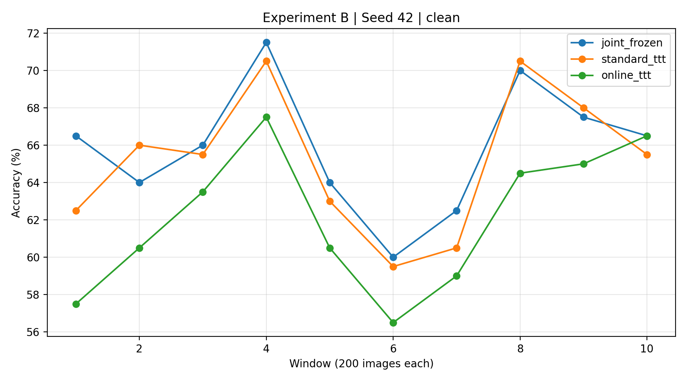
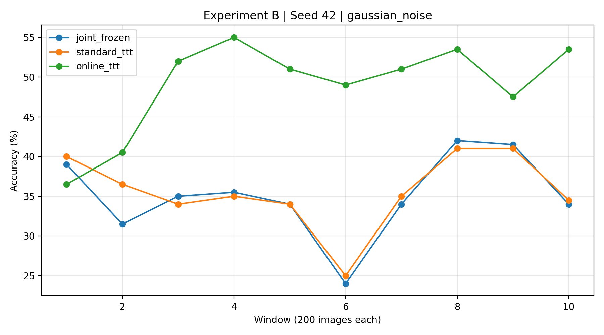

# TTT Results and Comparison — Experiments A and B

## Overview

I analyzed Nguyen's Experiment A and Tuong's Experiment B to see how standard TTT and online TTT perform on clean and corrupted images.

For both experiments, I compared the methods against the joint-frozen baseline since they use the same trained checkpoint. I also looked at runtime and how accuracy changes during adaptation.

Right now, we only have one seed for each experiment, so these are preliminary results.

## Experiment A — CIFAR-10 (Nguyen)

Experiment A uses CIFAR-10 with Gaussian noise at severity 5.

### Accuracy Results

| Method | Clean | Gaussian Noise |
|---|---:|---:|
| Supervised Frozen | 90.79% | 41.98% |
| Joint Frozen | 91.96% | 40.15% |
| Episodic TTT | 90.50% | 50.71% |
| Online TTT | 90.54% | 74.05% |

Compared to joint frozen:

- Episodic TTT: −1.46 pp on clean, +10.56 pp on noisy images.
- Online TTT: −1.43 pp on clean, +33.90 pp on noisy images.

Online TTT showed a big improvement on noisy images, going from around 40% to 74% accuracy. However, both TTT methods performed slightly worse on clean images.

For runtime, episodic TTT took around 945 seconds on clean images, while online TTT took around 103 seconds. This makes sense because episodic TTT used 10 updates per image, while online TTT used only one. These times are approximate values from the notebook logs.

## Experiment B — CIFAR-100 (Tuong)

Experiment B uses CIFAR-100 classes 0–19 with Gaussian noise at severity 3.

### Accuracy Results

| Method | Clean | Gaussian Noise |
|---|---:|---:|
| Supervised Frozen | 63.40% | 39.05% |
| Joint Frozen | 65.85% | 35.05% |
| Standard TTT | 65.15% | 35.60% |
| Online TTT | 62.10% | 48.95% |

Compared to joint frozen:

- Standard TTT: −0.70 pp on clean, +0.55 pp on noisy images.
- Online TTT: −3.75 pp on clean, +13.90 pp on noisy images.

Here, online TTT also improved noisy accuracy, while standard TTT barely made a difference. But online TTT had the largest drop on clean images.

### Windowed Accuracy

I plotted accuracy across 10 windows of 200 images each.

**Clean images**

Online TTT stayed below the frozen baseline for almost the entire test stream.

**Gaussian noise**

Online TTT performed better than the frozen baseline in 9 out of 10 windows. Its accuracy went from 36.5% in the first window to 55% in window 4.

This might be because online TTT keeps learning from previous test images instead of resetting after each one.

### Runtime

| Method | Clean | Gaussian Noise |
|---|---:|---:|
| Joint Frozen | 7.09 s | 6.67 s |
| Standard TTT | 34.08 s | 38.81 s |
| Online TTT | 38.67 s | 38.27 s |

Both TTT methods used 2,000 updates per run. Online TTT took about 5–6 times longer than frozen inference, so the accuracy improvement also comes with extra computation.

## Comparing Both Experiments

| | Experiment A | Experiment B |
|---|---|---|
| Dataset | CIFAR-10 | CIFAR-100 (20 classes) |
| Noise severity | 5 | 3 |
| Online TTT noisy improvement | +33.90 pp | +13.90 pp |
| Online TTT clean change | −1.43 pp | −3.75 pp |
| Seeds | 1 | 1 |

Both experiments showed a similar pattern. Online TTT helped with Gaussian noise but slightly hurt clean accuracy.

However, the experiments use different datasets and settings, so we can't directly compare which one performed better.

## Multi-Seed Analysis

I also updated the analysis script so it can combine results from both experiments and calculate mean accuracy, standard deviation, runtime, and accuracy changes compared to joint frozen.

The combined file has 16 rows, and the script produces 8 summary rows.

Since we only have one seed per experiment, the standard deviation is currently `NaN`. Once we get the remaining seeds, we can check whether the improvements are consistent.

The results are saved in `results/ttt_combined.csv` and `results/ttt_multiseed_summary.csv`.

## My Takeaways

The main thing I noticed is that online TTT seems helpful when images are corrupted, especially when the same type of noise continues throughout the test stream.

But it doesn't always help. In both experiments, clean accuracy dropped, and adaptation required extra computation.

We also only tested one seed per experiment and Gaussian noise, so I wouldn't say online TTT is always better yet.

## Next Steps

- Add Tuong's remaining seeds (43 and 44).
- Calculate mean and standard deviation across seeds.
- Test more corruption types.
- Look into why clean accuracy drops.
- Compare accuracy improvements with runtime costs.

**Overall:** Online TTT improved noisy accuracy by 33.90 percentage points in Experiment A and 13.90 points in Experiment B. The results look promising, but we need more testing before drawing a final conclusion.
